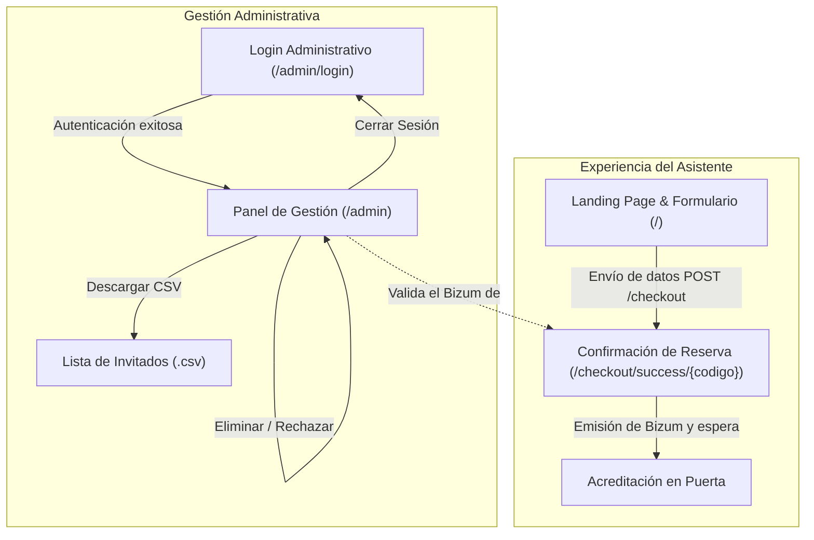

# Documentación del Proyecto: WebFiesta (Macrofiesta)

---

## 1. Concepto

**WebFiesta** es una plataforma web ligera, ágil y de alta conversión diseñada para la gestión integral y venta anticipada de entradas para eventos privados y fiestas juveniles. El sistema elimina la fricción de las plataformas de ticketing tradicionales al permitir a los asistentes reservar sus pases (entrada estándar o entrada con menú) en menos de un minuto y sin necesidad de crear una cuenta de usuario, canalizando los pagos de forma directa y libre de comisiones mediante **Bizum** con códigos alfanuméricos únicos de seguimiento (`FIESTA-XXX`). Al mismo tiempo, ofrece a los organizadores un panel de administración privado y centralizado desde el cual auditar transacciones en tiempo real, validar o revocar reservas y exportar listados oficiales de control de acceso en formato CSV directamente compatible con Microsoft Excel.

---

## 2. Características

La organización de eventos independientes y privados suele enfrentarse a un dilema recurrente: contratar plataformas comerciales de venta de entradas que retienen comisiones elevadas y exigen engorrosos registros a los asistentes, o recurrir a métodos informales en aplicaciones de mensajería propensos al caos organizativo, pagos extraviados y listas de invitados duplicadas. WebFiesta nace como respuesta directa a esta necesidad, implementando una arquitectura minimalista centrada en la experiencia de usuario (UX) que digitaliza y automatiza el proceso de reserva y admisión, manteniendo la flexibilidad y cercanía de los cobros entre particulares.

La aplicación opera bajo un modelo de confirmación asistida en dos fases: en la primera fase, el asistente selecciona su modalidad de entrada, cumplimenta sus datos de contacto y escoge el número de teléfono del organizador al que remitirá el pago; en la segunda fase, el sistema genera de forma determinista una referencia de reserva anti-colisión e instruye al usuario a emitir el Bizum en un plazo máximo de 24 horas. Los organizadores, provistos de un panel de mando protegido por clave de acceso, cotejan las alertas bancarias con las reservas registradas y, con un solo clic, acreditan el pago para el acceso al recinto.

### ¿Qué características hacen destacar a WebFiesta frente a otras soluciones?

* **Cobros directos mediante Bizum sin intermediarios ni comisiones:** Aprovecha la herramienta de pago instantáneo más extendida en España, permitiendo que el 100% de la recaudación llegue directamente a las cuentas de los organizadores sin tarifas por pasarela de pago (como Stripe o Redsys) ni retenciones de capital.
* **Reparto de carga de cobro (Balanceo multiteléfono):** Permite a los usuarios elegir entre múltiples números de teléfono receptores de Bizum configurados en el sistema, distribuyendo el volumen de transferencias entre varios organizadores para evitar bloqueos por límites bancarios mensuales.
* **Generación automática de códigos de referencia únicos (`FIESTA-XXX`):** Implementa un algoritmo de prevención de colisiones que asigna un identificador conciso y fácil de transcribir al concepto bancario, facilitando la conciliación de pagos sin margen de error.
* **Reserva ultra-rápida sin registro previo:** Diseñado con enfoque *mobile-first* y cero barreras de entrada; el asistente no requiere crear contraseñas, confirmar correos ni descargar aplicaciones nativas.
* **Panel de administración en tiempo real con acciones de un clic:** Permite supervisar el aforo, diferenciar visualmente el tipo de entrada mediante insignias de colores, aprobar reservas pagadas o descartar impagados de forma instantánea.
* **Exportación de listados optimizada para taquilla y puerta (CSV con BOM UTF-8):** Genera archivos CSV delimitados por punto y coma (`;`) e inyecta la marca de orden de bytes UTF-8 (BOM), asegurando que los nombres con tildes y caracteres especiales se abran correctamente en cualquier versión de Excel para el control presencial del evento.
* **Diseño inmersivo y reactivo (*Nightlife Aesthetic*):** Interfaz visual atractiva basada en paletas oscuras, tipografía estilizada, microinteracciones dinámicas y partículas animadas en CSS puro que elevan la percepción de marca y exclusividad del evento sin sobrecargar el rendimiento.

---

## 3. Ficha Técnica

| Tecnología / Herramienta | Categoría | Versión | Justificación Técnica y Razón de Uso |
| :--- | :--- | :--- | :--- |
| **PHP** | Lenguaje Backend | `^8.3` (8.3.33) | Lenguaje base robusto, tipado estricto, alto rendimiento mediante motor Zend y compatibilidad con las últimas características del ecosistema Laravel. |
| **Laravel Framework** | Framework Backend | `^13.17` (13.34) | Proporciona una arquitectura MVC elegante, enrutamiento semántico, Eloquent ORM para manejo de modelos, migraciones de base de datos declarativas y sistema de middleware de autenticación. |
| **SQLite / MySQL** | Base de Datos | SQLite 3 / MySQL 8.x | SQLite ofrece una base de datos local embebida sin sobrecarga de configuración para desarrollo y eventos ligeros; compatible de forma transparente con MySQL o PostgreSQL en producción mediante `.env`. |
| **Tailwind CSS** | Framework Frontend | `^4.0.0` (CDN v3/v4) | Facilita la construcción de interfaces limpias, adaptativas y con utilidades atómicas en vistas de checkout y administración sin hojas de estilos pesadas. |
| **CSS3 Nativo & Keyframes** | Estilos Frontend | CSS3 estándar | Hoja de estilos personalizada (`public/css/macrofiesta.css`) que implementa gradientes, efectos de desenfoque (`backdrop-filter`) y sistema de partículas flotantes optimizado por GPU sin librerías externas. |
| **JavaScript Vanilla** | Lenguaje Frontend | ES6+ | Manipulación ágil del DOM para la selección reactiva de entradas y actualización de costes en tiempo real sin requerir la sobrecarga o peso de frameworks SPA (React/Vue). |
| **Vite** | Empaquetador / Bundler | `^8.0.0` | Herramienta de compilación ultrarrápida para procesar assets y módulos modernos de JavaScript/CSS con Hot Module Replacement (HMR). |
| **Google Fonts (Outfit)** | Tipografía | Webfont API | Familia tipográfica sans-serif geométrica de alta legibilidad en pantallas móviles que refuerza la estética moderna del evento. |
| **Laravel Herd / PHP Built-in** | Entorno Servidor | N/A | Facilita el despliegue local inmediato y compatibilidad total con servidores Linux Nginx + PHP-FPM bajo Debian/Ubuntu para producción. |

---

## 4. Vistas de la Aplicación

El sistema cuenta con 4 vistas principales diseñadas de forma modular para cubrir el ciclo completo de adquisición de entradas y control administrativo.



---

### Vista 1: Landing Page y Formulario de Reserva (`welcome.blade.php`)

* **Ruta:** `GET /`
* **Nombre de ruta:** Raíz
* **Propósito:** Captar el interés de los asistentes, informar sobre los detalles del evento (fecha, localización, música en vivo) y permitir la reserva inmediata de entradas en dos modalidades: **Normal (15€)** o **Menú (25€)**.

#### Contenido
* **Cabecera Hero:** Título con tipografía de alto impacto y degradados ("MACROFIESTA"), etiqueta de evento exclusivo, detalles del evento (Mesón Posada de Millán, Algeciras) y llamada a la acción (*Call to Action*).
* **Sección de Precios interactiva:** Tarjetas comparativas de *Normal* (15€) y *Menú* (25€) con desglose de servicios incluidos (acceso, zona de fiesta, menú completo, consumición, acceso preferente).
* **Formulario de Reserva:** Campos para Nombre completo, Correo electrónico, Número de teléfono, selector visual de la entrada elegida y selección del organizador destino para el Bizum (634 46 90 24 o 671 78 40 16).
* **Fondo con Partículas:** Efecto visual dinámico de orbes luminosos flotantes.

#### Comportamiento
* Al pulsar sobre cualquiera de las tarjetas de precio, la función JavaScript `selectTipo()` actualiza dinámicamente la clase activa de la tarjeta, modifica el valor del campo oculto `tipo_entrada` y actualiza la previsualización del precio en el formulario.
* El botón principal realiza un desplazamiento fluido (*smooth scroll*) hacia el formulario.
* El formulario envía una solicitud `POST` a `/checkout`, donde se validan los campos en el servidor (`CheckoutController@store`), se genera el código único (`FIESTA-XXX`) y se redirige a la pantalla de éxito.

#### Representación de Interfaz
```text
+-----------------------------------------------------------------------+
|  🎉 EVENTO EXCLUSIVO                                                  |
|                      M A C R O F I E S T A                            |
|       La noche que no olvidarás. Música, ambiente y experiencia.     |
|       📅 Próximamente  |  📍 Posada de Millán, Algeciras  | 🎶 DJ Vivo |
|                          [ Consigue tu Entrada ↓ ]                    |
+-----------------------------------------------------------------------+
|                         ELIGE TU ENTRADA                              |
|   +--------------------------+     +--------------------------+       |
|   |         NORMAL           |     |     RECOMENDADO: MENÚ    |       |
|   |          15 €            |     |           25 €           |       |
|   | ✓ Acceso al evento       |     | ✓ Todo lo de Normal      |       |
|   | ✓ Zona de fiesta         |     | ✓ Menú + Bebida incluida |       |
|   | ✓ Música en vivo         |     | ✓ Acceso preferente      |       |
|   +--------------------------+     +--------------------------+       |
+-----------------------------------------------------------------------+
|                       COMPLETA TU RESERVA                             |
|   Nombre completo:      [ Carlos García                      ]        |
|   Email:                [ carlos@ejemplo.com                 ]        |
|   Teléfono:             [ 600 12 34 56                       ]        |
|   Entrada elegida:      [ Normal - 15€                       ]        |
|   Bizum al número:      (•) 634 46 90 24    ( ) 671 78 40 16         |
|                                                                       |
|                     [ 🎟️ RESERVAR ENTRADA ]                          |
+-----------------------------------------------------------------------+
```

---

### Vista 2: Confirmación de Reserva e Instrucciones de Pago (`checkout/success.blade.php`)

* **Ruta:** `GET /checkout/success/{codigo}`
* **Nombre de ruta:** `checkout.success`
* **Propósito:** Mostrar al asistente el resumen de su reserva pendiente, el importe exacto a transferir y las instrucciones precisas para completar el Bizum.

#### Contenido
* **Encabezado de Estado:** Banner verde de confirmación con icono de verificación y aviso: *"¡Reserva Registrada! Solo falta el pago para confirmar tu asistencia"*.
* **Caja de Instrucciones de Pago (Bizum):**
  * Importe total a abonar (calculado dinámicamente: 15€ o 25€ mediante el accessor Eloquent `$entrada->precio`).
  * Número de teléfono receptor seleccionado por el usuario en tamaño destacado.
  * Código de reserva anti-colisión resaltado en tipografía monoespaciada dentro de una caja con borde punteado (ej. `FIESTA-K9L`).
* **Avisos Informativos:** Instrucción de indicar **exactamente** dicho código en el concepto del Bizum y advertencia de cancelación automática en caso de no recibir el pago en 24 horas.
* **Navegación:** Enlace directo para regresar a la página principal.

#### Comportamiento
* La ruta consulta en base de datos la entrada correspondiente al código facilitado mediante `Entrada::where('codigo_reserva', $codigo)->firstOrFail()`. Si el código no existe, devuelve un error HTTP 404.

#### Representación de Interfaz
```text
+-----------------------------------------------------------------------+
|                          ✓ ¡Reserva Registrada!                       |
|               Solo falta el pago para confirmar tu asistencia.        |
+-----------------------------------------------------------------------+
|                                                                       |
|   Para confirmar tu entrada, haz un Bizum de 15€ al número:           |
|                                                                       |
|                           634 46 90 24                                |
|                                                                       |
|   Indicando EXACTAMENTE en el concepto este código:                   |
|   + - - - - - - - - - - - - - - - - - - - - - - - - - - - - - - - +   |
|   |                        FIESTA-7XA                             |   |
|   + - - - - - - - - - - - - - - - - - - - - - - - - - - - - - - - +   |
|                                                                       |
|   Una vez recibido el pago, validaremos tu entrada en el sistema.     |
|   ⚠ Si no recibimos el Bizum en 24 horas, tu reserva será cancelada.  |
|                                                                       |
|                       < Volver a la página principal                  |
+-----------------------------------------------------------------------+
```

---

### Vista 3: Autenticación Administrativa (`admin/login.blade.php`)

* **Ruta:** `GET /admin/login`
* **Nombre de ruta:** `admin.login`
* **Propósito:** Proteger el acceso a la información confidencial de los asistentes y a la gestión financiera de la fiesta mediante una contraseña de administración.

#### Contenido
* Tarjeta centrada con título *"Acceso Privado"*.
* Alerta de error estilizada en caso de credenciales incorrectas.
* Formulario con campo de contraseña enmascarada (`type="password"`).
* Botón de acceso de alto contraste (*"Entrar al Panel"*).

#### Comportamiento
* Si un administrador ya cuenta con sesión activa (`session('admin_logged_in') == true`), el controlador lo redirige inmediatamente al panel sin mostrar el formulario.
* Al enviar el formulario vía `POST /admin/login`, se compara el valor introducido con la variable de entorno `ADMIN_PASSWORD` (por defecto `fiesta123`). En caso de éxito, se almacena la variable de sesión y se redirige a `/admin`; en caso contrario, se devuelve a la vista con mensaje de error explícito.

#### Representación de Interfaz
```text
+-------------------------------------------------------------+
|                                                             |
|                       Acceso Privado                        |
|                                                             |
|         Contraseña:                                         |
|         [ •••••••••••••••••••••••••••••••••• ]              |
|                                                             |
|                     [ Entrar al Panel ]                     |
|                                                             |
+-------------------------------------------------------------+
```

---

### Vista 4: Panel de Gestión y Control de Entradas (`admin/index.blade.php`)

* **Ruta:** `GET /admin`
* **Nombre de ruta:** `admin.index`
* **Middleware:** `AdminAuth` (restringe el acceso a peticiones no autenticadas hacia `/admin/login`).
* **Propósito:** Servir como centro de control para la verificación de pagos, gestión del aforo y descarga de la lista oficial de admitidos.

#### Contenido
* **Barra de Navegación Superior:**
  * Título del panel de control.
  * Botón de acción rápida verde con icono SVG para **"Descargar Lista (CSV)"**.
  * Botón rojo de **"Cerrar Sesión"** (destruye la sesión del administrador).
* **Alertas Flash:** Notificaciones de confirmación de operaciones exitosas (ej. *"Entrada marcada como pagada"* o *"La entrada ha sido rechazada y eliminada"*).
* **Tabla de Asistentes:**
  * **ID:** Identificador interno correlativo.
  * **Participante:** Nombre del asistente, email y teléfono de contacto.
  * **Entrada:** Badge distintivo con fondo púrpura para entradas con *Menú* o azul para entradas *Normal*.
  * **Código Reserva:** Código alfanumérico en fuente monoespaciada para contraste rápido con la app de Bizum.
  * **Bizum A:** Teléfono al que el comprador indicó haber enviado el Bizum.
  * **Estado:** Insignia verde para *"Pagado"* y roja para *"Pendiente"*.
  * **Acciones:**
    * Botón *"Marcar como Pagado"* (solo visible en entradas pendientes; al pulsar cambia el estado a completado y genera el evento de notificación).
    * Botón *"Eliminar"* (ejecuta una petición `DELETE` con confirmación nativa de seguridad para evitar borrados accidentales).

#### Comportamiento
* **Validación de Pago (`POST /admin/{id}/pay`):** Actualiza el atributo `estado_pago` a `true` y emite un log del sistema listo para enganchar a colas de mensajería (Mailable/SMS).
* **Rechazo de Reserva (`DELETE /admin/{id}/reject`):** Elimina permanentemente el registro en base de datos liberando la plaza.
* **Descarga CSV (`GET /admin/download`):** Filtra únicamente las entradas cuyo estado sea pagado, las ordena alfabéticamente por tipo y nombre, inyecta la cabecera UTF-8 BOM (`\xEF\xBB\xBF`) y las sirve con delimitador de punto y coma `;` para apertura nativa e inmediata en Excel en español.

#### Representación de Interfaz
```text
+-----------------------------------------------------------------------------------------------------------------------+
|  Panel de Administración                             [ ⬇ Descargar Lista (CSV) ]   [ 🚪 Cerrar Sesión ]                |
+-----------------------------------------------------------------------------------------------------------------------+
|  [✓ Entrada marcada como pagada. Email de confirmación programado.                                               ]   |
+----+-----------------------+----------+----------------+--------------+------------+----------------------------------+
| ID | Participante          | Entrada  | Código Reserva | Bizum A      | Estado     | Acciones                         |
+----+-----------------------+----------+----------------+--------------+------------+----------------------------------+
| 1  | Carlos García         | [Normal] | FIESTA-7XA     | 634 46 90 24 | [Pagado]   | Completado  [ Eliminar ]         |
|    | cgarcia@email.com     |          |                |              |            |                                  |
|    | 600123456             |          |                |              |            |                                  |
+----+-----------------------+----------+----------------+--------------+------------+----------------------------------+
| 2  | Lucía Martínez        | [Menú]   | FIESTA-B92     | 671 78 40 16 | [Pendiente]| [ Marcar Pagado ]  [ Eliminar ]  |
|    | lucia@email.com       |          |                |              |            |                                  |
|    | 678901234             |          |                |              |            |                                  |
+----+-----------------------+----------+----------------+--------------+------------+----------------------------------+
```

---

## 5. Diagramas de Flujo y Casos de Uso

### Flujo 1: Ciclo de Compra del Asistente
```text
[ Usuario accede a la web ]
             │
             ▼
[ Explora la oferta y elige modalidad: Normal o Menú ]
             │
             ▼
[ Rellena formulario y selecciona teléfono de Bizum ]
             │
             ▼
[ POST /checkout ] ──> (Validación de datos y asignación de código FIESTA-XXX)
             │
             ▼
[ Redirección a /checkout/success/{codigo} ]
             │
             ▼
[ Asistente abre su app bancaria y emite Bizum con el concepto exacto ]
```

### Flujo 2: Ciclo de Validación del Organizador
```text
[ Administrador accede a /admin/login ]
             │
             ▼
[ Introduce contraseña maestra ] ──> (¿Válida?) ──No──> [ Notificación de error ]
             │ Sí
             ▼
[ Accede al Panel /admin ]
             │
             ├──> [ Revisa notificaciones de Bizum recibidas en el móvil ]
             │               │
             │               ▼
             │    [ Pulsa "Marcar como Pagado" sobre el registro correspondiente ]
             │               │
             │               ▼
             │    (El estado pasa a Pagado y se genera el registro para email)
             │
             └──> [ Día del Evento: Pulsa "Descargar Lista (CSV)" ]
                             │
                             ▼
                  (Apertura en Excel para control de acceso en puerta)
```

